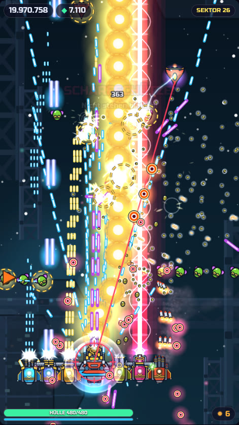
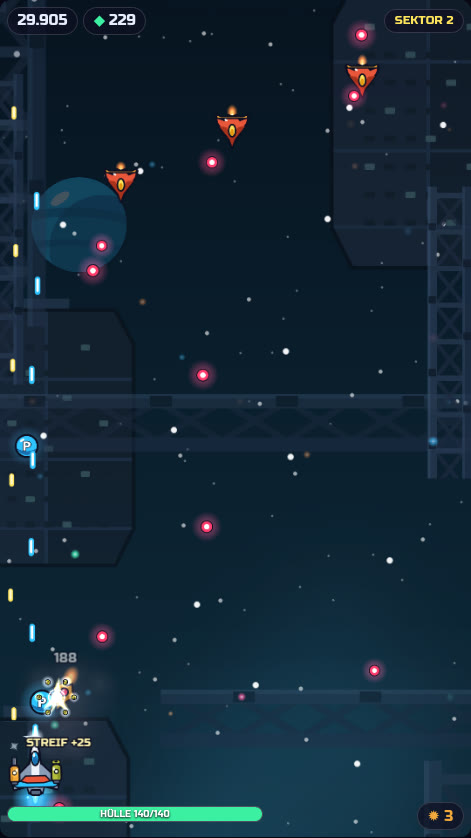
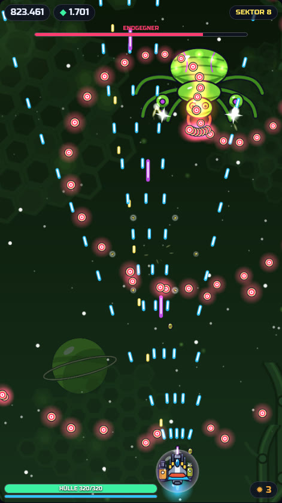
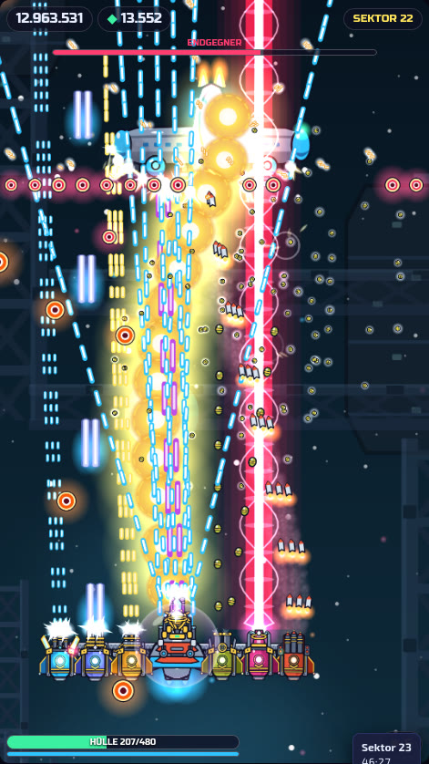
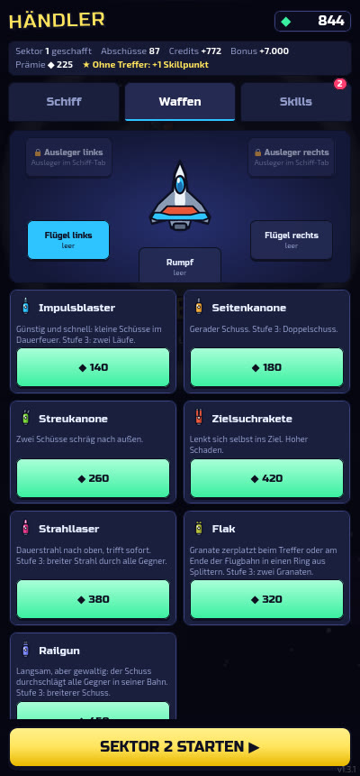
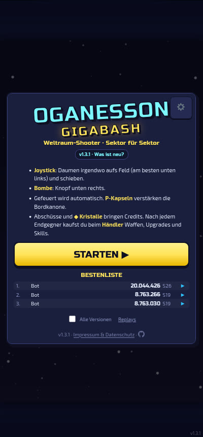
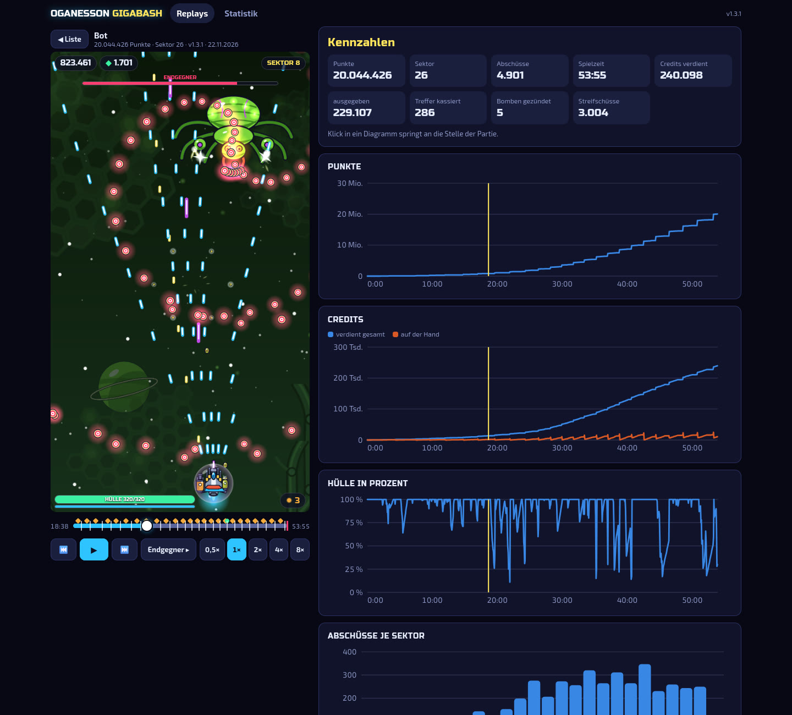

# Oganesson GigaBash

A vertical space shooter for the browser. Fight your way through sector after sector – enemy waves, frigates and a
boss at the end of each one – and spend your credits at the trader between the sectors: wing and hull cannons with
five levels each, ship upgrades, a skill tree with five branches and, for the endgame, a cruiser and a battleship.
The playfield is always portrait, so it plays just as well on a phone as on the desktop.

> The game is in **German**. The code comments are in German, too.



## Play

**Just open the HTML file.** The whole game – code, graphics, sounds, music and fonts – is a single, self-contained
`gigabash.html`. Download it from the [latest release](https://github.com/hobbyquaker/gigabash/releases/latest)
and open it in any modern browser by double-clicking. No installation, no server, no internet connection needed;
your best score is stored locally in the browser.

Building it yourself is just as quick: `npm ci && npm run build`, then open `dist/oganesson.html`.
The shared online leaderboard only exists when the file is served by the GigaBash server (see below).

**Controls:** WASD / arrow keys or drag with the mouse · B / space: smart bomb · P / Esc: pause. On touch devices a
virtual joystick (thumb anywhere on the field) or direct dragging, the bomb button sits bottom right.

### Docker quickstart

Want the shared leaderboard, replays and statistics for your friends or family? Run the server with one command:

```sh
docker run -d --name gigabash -p 8080:8080 \
  -e SECRET="$(openssl rand -hex 32)" \
  -v gigabash-data:/data \
  ghcr.io/hobbyquaker/gigabash:latest
```

Then open <http://localhost:8080/> – the replay viewer lives at `/replay`. More options are under
[Hosting with Docker](#hosting-with-docker).

## Features

- **Sectors instead of levels:** every sector is a generated sequence of enemy waves – swarmers, hunters, spinners,
  kamikazes, mines, bombers, turrets, snipers and heavy frigates – and ends with a boss with several attack phases.
  It gets tougher with every sector, the backdrop changes every few sectors.
- **Trader between the sectors:** 12 cannons for the wing and hull slots (pulse blaster, side cannon, spread cannon,
  homing missile, beam laser, flak, railgun, pulse laser, rear cannon, companion drone, lightning arc, plasma orb), each
  with five levels and an evolution at level 5. Outriggers make the ship wider and add more slots.
- **Ship upgrades:** armor, shield, repair drones, reactive plating, engine, cooling, caliber, targeting computer
  (critical hits), magnet, salvage contract, bomb bay, graze amplifier, overdrive.
- **Skill tree:** five branches (firepower, defense, technology, weapon master, pilot) with six tiers each.
- **Endgame ship classes:** from sector 20 the cruiser, from sector 30 the battleship – bigger hulls with turrets, more
  gun barrels and extra slots.
- **Stay in motion:** P capsules power up the main gun, grazing enemy bullets fills the bomb meter, and whoever sits
  still gets locked on – snipers move in and hits hurt more and more.
- **Works everywhere:** desktop with keyboard or mouse, phones and tablets with a virtual joystick, installable as a
  home-screen web app. The whole game is a single HTML file that even runs from `file://`.
- **Shared leaderboard with server-side verification:** every submitted game includes its replay; the server
  re-simulates it with the same deterministic engine before it enters the list. The leaderboard is grouped by
  simulation version, so scores are only compared with games played under the same rules.
- **Replay viewer** with seeking, speed control, jumps to sectors and bosses, charts and all purchases of a game,
  plus a statistics page.
- **No external assets:** all graphics are SVG generated in code, all sound effects are synthesized
  ([ZzFX](https://github.com/KilledByAPixel/ZzFX)), the music is procedural.

## Screenshots

| Early game: sector 2 with a small wing loadout | Boss fight in sector 8 |
|---|---|
|  |  |

| Endgame boss in sector 22 | Trader |
|---|---|
|  |  |

| Start screen with leaderboard | Replay viewer |
|---|---|
|  |  |

## Building

Requires **Node.js 24** (the server uses the built-in `node:sqlite`).

```sh
npm ci
npm run build        # type check + single-file builds → dist/oganesson.html (game) and dist/replay.html (replay viewer)
```

### With leaderboard

```sh
npm run build:all    # game + server bundle
SECRET=$(openssl rand -hex 32) npm start
# → http://localhost:8080/
```

### Development

```sh
npm start            # API server on :8080 (after npm run build:all)
npm run dev          # Vite dev server with hot reload, proxies /api to :8080
```

With `?debug` in the URL the running scene is available in the browser console as `oganesson.scene`,
e.g. `oganesson.scene.sim.credits = 99999`. `?touch` forces the touch controls on desktop.

## Hosting with Docker

A ready-made image (linux/amd64 and linux/arm64) is published to the GitHub Container Registry for every release:

```sh
docker run -d --name gigabash -p 8080:8080 \
  -e SECRET="$(openssl rand -hex 32)" \
  -v gigabash-data:/data \
  ghcr.io/hobbyquaker/gigabash:latest
# → http://localhost:8080/
```

Tags: `latest` and `X.Y.Z` / `X.Y` for releases, `edge` for the current `main` branch. Keep `SECRET` stable across
restarts – it signs the game starts. To build the image yourself with Docker Compose:

```sh
echo "SECRET=$(openssl rand -hex 32)" > .env
echo "ADMIN_TOKEN=$(openssl rand -hex 24)" >> .env
docker compose up -d --build
# → http://localhost:8080/
```

The multi-stage image only contains the built game, the server bundles and the preview images; the SQLite database
lives in the volume `/data`. Running behind a reverse proxy, also under a sub path, is supported – set `PUBLIC_URL`
and `TRUST_PROXY=1`.

| Variable | Default | Meaning |
|---|---|---|
| `SECRET` | random (games become invalid on restart) | HMAC key for signed game starts, at least 16 characters |
| `ADMIN_TOKEN` | empty | Bearer token for the admin endpoints (delete entries, telemetry export); empty = disabled |
| `PORT` / `HOST_PORT` | `8080` | Port in the container / on the host (Compose) |
| `DB_PATH` | `/data/oganesson.db` | SQLite file |
| `TRUST_PROXY` | `0` | `1` = take the client IP from the last `X-Forwarded-For` entry |
| `PUBLIC_URL` | empty | Public address without trailing `/`, used for link previews (`og:image`, `og:url`) |
| `RUN_MAX_AGE` | `259200` | How long a game start stays valid, in seconds |
| `MAX_BODY` | `4000000` | Largest accepted request (a submitted replay) in bytes |
| `RATE_SCALE` | `1` | Factor for all rate limits (`0` = off) |
| `VERIFY_WORKERS` | `1` | Worker threads for replay re-simulation |
| `VERIFY_TIMEOUT` | `30` | Upper limit for one re-simulation in seconds |
| `VERIFY_QUEUE` | `20` | Maximum number of waiting re-simulations (above: HTTP 503) |
| `TELEMETRY` | `1` | Store anonymous replays of all submissions (without name and IP) for balancing; `0` = off |
| `IMPRESSUM_NAME`, `IMPRESSUM_ADDRESS`, `IMPRESSUM_EMAIL` | empty | Operator details for the legal notice page `/impressum` (required for public hosting in Germany); address lines separated by `\|` |
| `LOG_RETENTION_DAYS` | `14` | Log retention mentioned in the privacy policy text |

## How it works

- **Deterministic simulation** (`src/core/`): fixed time step of 60 ticks per second, seeded RNG, no engine
  dependencies and only platform-independent math (`dmath.ts`), so the browser, Node and the verification worker
  produce bit-identical results. A replay is just the seed, the run-length encoded inputs and the trader actions with
  their tick.
- **Frozen rules:** before every release that changes the game logic, the simulation core of the previous version is
  frozen into `server/cores/v<version>/` (`npm run freeze-core`). The server verifies a game with the core of the
  version it was played with, so a score still counts after an update, and the replay viewer can play back old games.
  Versions whose cores are identical form one simulation version on the leaderboard.
- **Rendering** (`src/scenes/`) with [Phaser 3](https://phaser.io/), UI in plain DOM (`src/ui.ts`, `src/ui/`).
- **Server** (`server/src/`): plain `node:http`, SQLite, signed run tokens, plausibility checks, re-simulation in
  worker threads, rate limits, link previews and statistics.

| Path | Content |
|---|---|
| `src/core/` | Simulation: `sim/sim.ts` (game logic), `sector.ts` (wave generator), `data/` (enemies, weapons, upgrades, skills) |
| `src/scenes/GameScene.ts` | Phaser scene: rendering, input, effects |
| `src/assets/sprites.ts` | All graphics as SVG code |
| `src/audio/` | Synthesized sound effects and procedural music |
| `src/replay/`, `replay.html` | Replay viewer (separate single-file build `dist/replay.html`, served at `/replay`) |
| `server/src/` | HTTP server, API, database, verification |
| `server/cores/` | Frozen simulation cores of older versions |
| `scripts/` | Build helpers, core freezing, artwork renderer, audio level check |
| `tests/`, `server/test/` | Determinism, replay snapshot, balance bot and API tests |

## Tests

```sh
npm run test:sim       # determinism of the simulation, forbidden math in the core
npm run test:replay    # replay keyframes: resumed from snapshot == simulated straight through (all cores)
npm run test:server    # API integration tests incl. replay verification with frozen cores
npm run balance        # balance bots playing directly on the simulation (takes several minutes)
```

## License

Copyright © 2026 hobbyquaker

Oganesson GigaBash is free software: you can redistribute it and/or modify it under the terms of the
[GNU Affero General Public License v3.0](LICENSE) or (at your option) any later version. If you run a modified
version as a network service, you have to make its source code available to its users.

Third-party components: [Phaser](https://github.com/phaserjs/phaser) and [ZzFX](https://github.com/KilledByAPixel/ZzFX)
(MIT), fonts [Exo 2](https://fonts.google.com/specimen/Exo+2) and [Russo One](https://fonts.google.com/specimen/Russo+One)
(SIL Open Font License 1.1). Their license texts are bundled into the build (`dist/third-party-licenses.txt`, served at
`/third-party-licenses.txt`).
